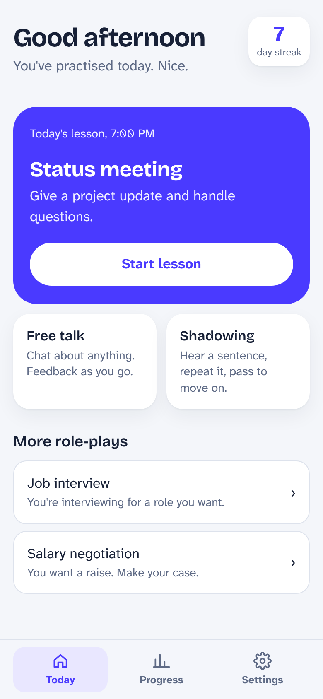
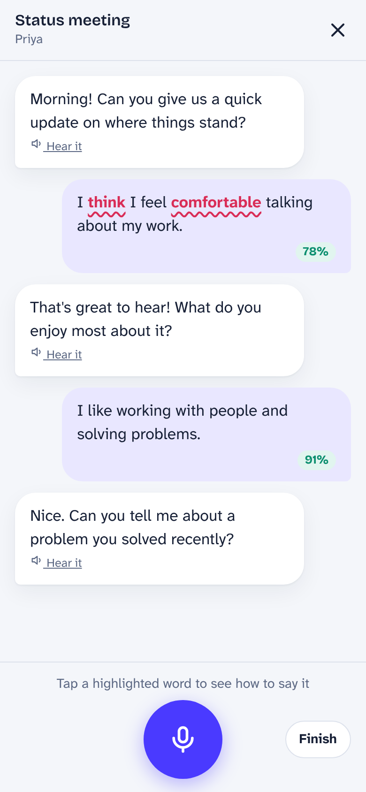
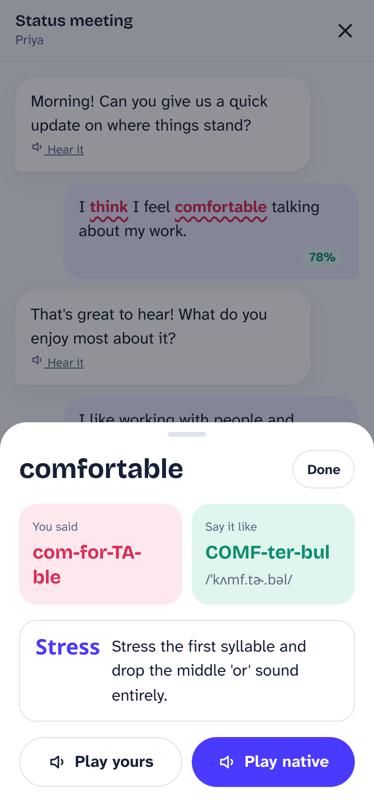
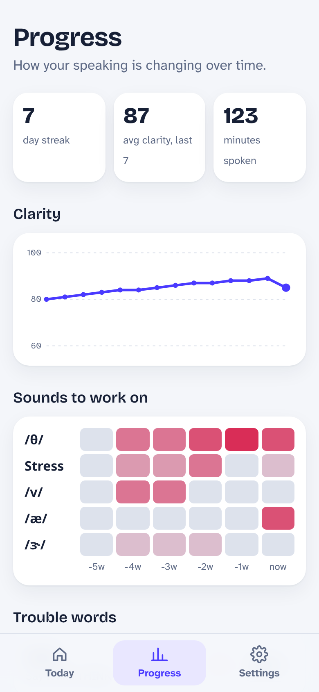

# Accent Coach

Talk to an AI coach, see exactly which sounds slipped, and fix them.
A mobile-first web app powered by Gemini's audio understanding, plus an
agent pipeline that turns GitHub issues into tested, reviewed pull requests.

   

More in [docs/screenshots](docs/screenshots) · [walkthrough GIF](docs/walkthrough.gif)

**What's here**

| | |
|---|---|
| **The app** | Onboarding (goal, accent, practice time) · **live voice** free talk and role-play (talk naturally, the coach answers out loud and you can interrupt) with flagged words · "Said vs. Expected" card with play-yours / play-native · shadowing loop · end-of-session takeaway · clarity trend, problem-sound heatmap, trouble-word bank, history · streaks · calendar reminder · installable on your phone |
| **The pipeline** | Label an issue `agent` → it builds, opens a PR → CI + UI tests (videos on the PR) → security review → you merge (or auto-merge). It stops and asks when something is unclear or it's stuck, and your reply resumes it. |

---

## Run the app

```bash
npm ci
cp .env.example .env.local     # add GEMINI_API_KEY for real coaching
npm run dev                    # http://localhost:3000
```

Without a key the app runs in **demo mode**: everything works, feedback is sample data, and a banner says so.
Open it on your phone (same Wi-Fi, `http://<your-computer-ip>:3000`) to try the mic; browsers only allow the mic on `localhost` or HTTPS, so for real phone testing deploy it (below).

**Deploy:** this repo deploys to Cloudflare Workers through the [OpenNext](https://opennext.js.org/cloudflare) adapter (`wrangler.jsonc`). Connect the repo in Cloudflare (Workers & Pages → Create → Import a repository) and every merge to `main` deploys. Set the key with `npx wrangler secret put GEMINI_API_KEY`. `npm run deploy` deploys by hand, and `npm run preview` runs the Workers build locally. On your phone, open the site and use *Add to Home Screen*.

The default model is `gemini-3.8-flash`. Override it with `GEMINI_MODEL`. Live voice conversations use `gemini-3.8-live` (override with `GEMINI_LIVE_MODEL`; `GEMINI_LIVE_API_VERSION` defaults to `v1beta`). The browser connects to Gemini Live with a single-use token from `/api/live`, so the API key never leaves the server. Headphones give the cleanest conversation.

---

## Set up the agent pipeline (about 10 minutes)

> **Using Claude Code?** Unzip, open the folder in Claude Code, and say *"set this repo up on GitHub"*. It follows [SETUP.md](SETUP.md) and stops when it needs you (installing the GitHub App, adding your token). The steps below are the same thing, by hand.

1. **Push this repo to GitHub** (private is fine).
2. **Install the Claude GitHub App** on the repo: <https://github.com/apps/claude>.
   This matters: commits the agent pushes as `claude[bot]` trigger CI. (Pushes made with the default Actions token don't.)
3. **Add one secret** (Settings → Secrets and variables → Actions → *New repository secret*). Pick either:
   - `CLAUDE_CODE_OAUTH_TOKEN` **(uses your Claude Pro/Max plan, no API billing).** On your computer run `claude setup-token`, sign in, and paste the token it prints. Agent runs count toward your plan's usage limits, the same as using Claude Code yourself.
   - `ANTHROPIC_API_KEY` (pay per use, from [console.anthropic.com](https://console.anthropic.com)). Better if many people trigger it or you don't want it eating your own limits.

   CI never needs your Gemini key; tests run in demo mode.
4. **Protect `main`:** Settings → Rules → Rulesets → New branch ruleset for `main`:
   - Require a pull request before merging
   - Require status checks: `Typecheck, unit tests, build`, `UI tests (Playwright)`, `agent/security-review`
     (they appear in the list after the first PR has run)
5. **Optional, auto-merge:** Settings → Secrets and variables → Actions → **Variables** → `AGENT_AUTO_MERGE` = `true`.
   The pipeline then merges a PR itself only when tests pass, the security review approves with nothing above low severity, and the reviewer rates it **high or medium confidence**. A PR waits for you, with the reason on the PR, when the reviewer rates it low (unsure, or a decision a human should make, such as risk to saved data, key/auth/rate-limit handling or a new third party), or when it touches `lib/ai/guard.ts`, `lib/ai/gemini.ts`, dependencies, build/deploy config, `.github/` or secrets. This works on any GitHub plan.
6. **Optional, full HTML test reports:** Settings → Pages → Deploy from branch → `test-media` / root.
   (Appears after the first PR. Pages on private repos needs a paid plan; without it, the comment links to the run instead.)

Labels are created automatically on first use.

### Using it

| You do | The pipeline does |
|---|---|
| Add the `agent` label to an issue | Builds it on `agent/issue-N`, opens a PR that closes the issue |
| Answer its questions on the issue | Picks up where it stopped |
| Reply on a blocked PR with guidance | Applies it, with a fresh budget of 3 attempts |
| Comment `/agent <request>` on its PR | Makes that change |
| Comment `/agent stop` (or remove the label) | Stops and clears its labels |
| Comment `/agent retry` | Starts again (on the same PR if one is open) |
| Add `- [ ] items` to `PLAN.md` on main | Creates issues and runs them one at a time |

Labels show where everything is: `agent:working`, `agent:needs-input` (waiting for you), `agent:in-review`, `agent:blocked` (waiting for you), `agent:queued`.

Each issue gets **one** status comment that edits itself. You're only notified when it needs you, or when something is ready.

### Settings (repository variables)

| Variable | Default | |
|---|---|---|
| `AGENT_MAX_FIX_ATTEMPTS` | `3` | Automatic fix tries before it stops and asks you |
| `AGENT_AUTO_MERGE` | `false` | Merge automatically when tests and review pass **and** the reviewer rates the PR high or medium confidence (never for the guard, Gemini client, dependencies, config or pipeline files) |

### Safety

- Only people with **write access** can start or steer the agent. Comments from anyone else are ignored and never reach the agent's prompt.
- Bot comments and the pipeline's own comments never trigger it, so it can't loop.
- The agent can't edit `.github/`, force-push, read secrets, or use `curl`/`wget`. The fix job refuses to push to any branch that isn't `agent/issue-*`.
- Forks never get agent runs or reviews.
- The review only *reads* PR code. A reviewer can be fooled by text in the code it's reviewing, so keep a human merge step until you trust it.

---

## How it's tested

```bash
npm test                  # 63 tests: app logic + 31 pipeline scenarios + CLI against a mock GitHub API
npx playwright test       # 10 UI tests on mobile Chrome with a fake microphone
npm run agent:scenarios   # writes docs/PIPELINE_SCENARIOS.md: a readable log of every scenario
```

The pipeline's decisions live in plain modules (`.github/agent/*.mjs`); the workflows just call them. A simulator (`.github/agent/sim`) replays real GitHub events (labels, replies, CI failing, reviews rejecting, strangers commenting, a PR closed, PLAN.md queues…) through that same code. See [docs/PIPELINE_SCENARIOS.md](docs/PIPELINE_SCENARIOS.md).

**What the simulator can't prove:** GitHub-side plumbing (tokens, app permissions, the Claude action's inputs). Do the live check below once after setup.

### First live check on GitHub

1. Open an issue "Add a 'Slow' button to the Said vs Expected sheet", add the `agent` label. Expect: `agent:working` → a PR → CI with a GIF comment → security review → "Ready for you to merge".
2. Open a vague issue "Make the app better", label it. Expect: it asks questions and labels `agent:needs-input`. Reply; it continues.
3. On the PR from step 1, comment `/agent make the button say "Slower"`. Expect a new commit and CI again.
4. Comment `/agent stop` on the issue from step 2. Expect labels cleared.

If a step doesn't behave, the Actions tab → **Agent** run → `decide` step logs one line saying what it decided and why.

---

## Project layout

```
app/                 pages + API routes (Gemini)
components/          UI
lib/                 logic (audio encoding, scoring, streaks, store, prompts, schemas, mock coach)
tests/unit, tests/e2e
.github/workflows    ci.yml · agent.yml · review.yml · plan.yml
.github/agent        pipeline logic, prompts, simulator, tests
CLAUDE.md            instructions the agents follow
SETUP.md             setup runbook Claude Code follows (GitHub repo, secrets, protection, smoke test)
PLAN.md              optional queue of work
```
